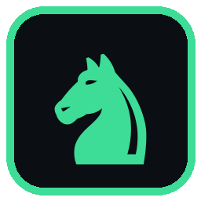
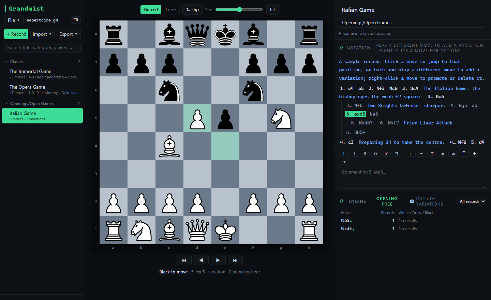
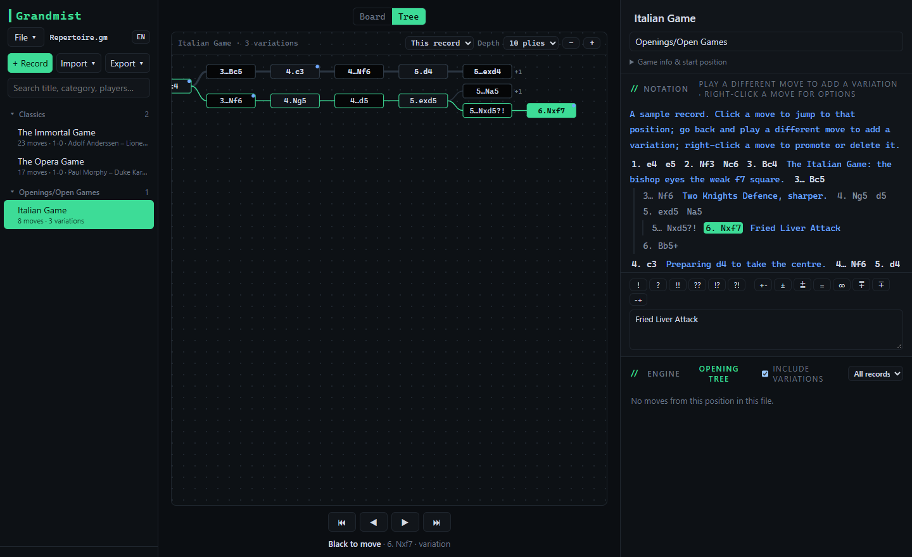
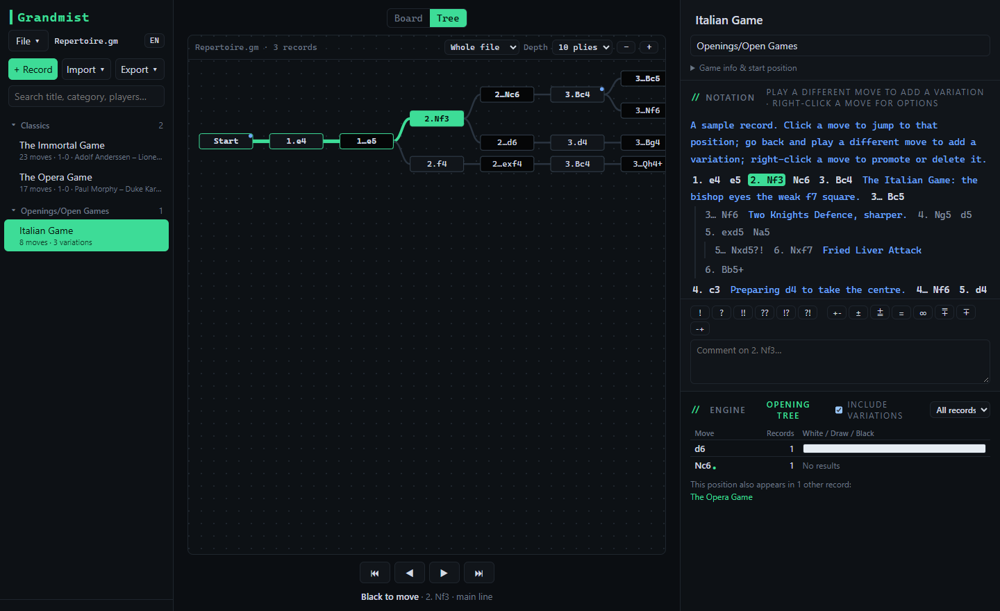
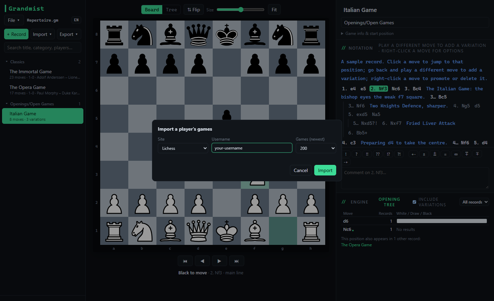
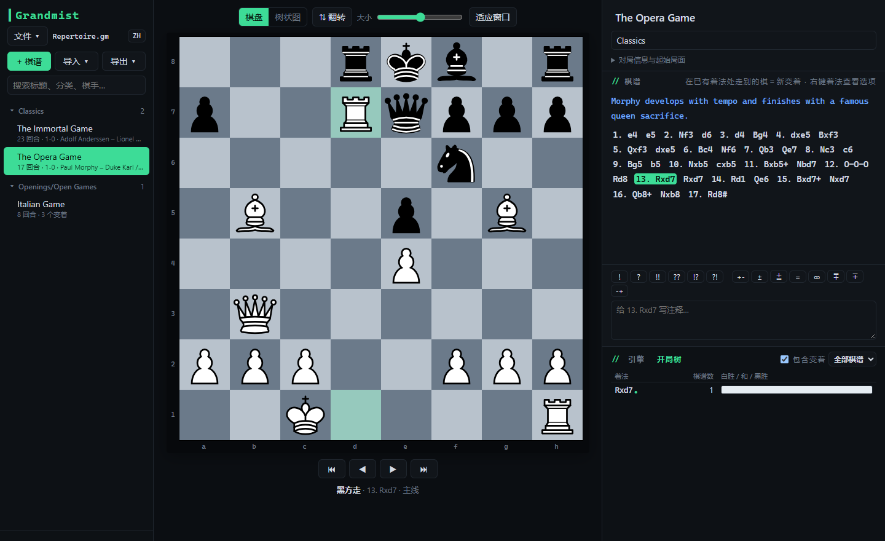

<p align="center">
  
</p>

<h1 align="center">Grandmist</h1>

<p align="center"><b>A chess visualization toolkit for Windows.</b><br>
Build your repertoire, explore every branch as a tree, analyse with your favourite engine.</p>

<p align="center">
  <a href="../../releases/latest">Download</a> ·
  <a href="#features">Features</a> ·
  <a href="#getting-started">Getting started</a> ·
  <a href="#license">License</a>
</p>



## Features

**Your games and repertoire, organised**
- **`.gm` files** — one file holds a whole collection: every game, category, variation and comment. Create, open and save them like any document and manage them in Windows Explorer; double-click a `.gm` file to open it.
- **Variations and comments** — play a different move anywhere to branch off; promote, reorder or delete lines; annotate with comments and symbols such as `!`, `?!` or `±`.
- **Categories and search** — group records like *Openings / Sicilian Defence* and find them instantly.

**See the shape of your chess**
- **Tree view** — every branch of a record, or of the whole file, drawn as a real move tree. Hover a node to preview the position, click to jump there.
- **Opening tree** — which moves were played from the current position across the file, with results, transpositions included.




**Engines**
- Load any UCI engine you have, such as **Stockfish** or **Lc0**, and analyse live: evaluation, win / draw / loss bar and the top three lines. Click a move in a line to add it to your notes.

**Import**
- **Lichess and Chess.com** — enter a username and turn that player's games into a `.gm` file, sorted by colour and opening.
- **PGN** — import and export with variations and comments, compatible with ChessBase, Lichess and other tools.



**Languages**
- English, Chinese and Russian built in. Add another language by dropping a translated `xx.json` into a `lang` folder next to the app.



## Getting started

1. Download `Grandmist.exe` from the [latest release](../../releases/latest) and run it. No installation needed.
   Windows may show a SmartScreen warning because the app is not code-signed yet: click **More info → Run anyway**.
2. Play through a game, or use **File → Import from Lichess / Chess.com…**, then **Ctrl+S** to save it as a `.gm` file (saved to `Documents\Grandmist` by default).
3. Optional — add an engine. Engines are separate programs that you download yourself:
   - **Stockfish**: [stockfishchess.org/download](https://stockfishchess.org/download/)
   - **Lc0**: [lczero.org](https://lczero.org/) (put a network file next to `lc0.exe`)

   Then open the **Engine** tab, click **+** and choose the engine's `.exe`. Press **Space** to start or stop analysis.

**Keyboard:** ← → move through the game · ↑ ↓ switch between variations · F flip the board · G switch board / tree · Ctrl+N / O / S file commands.

## Run from source

Requires Windows and Python 3.10+:

```bash
pip install pywebview pyinstaller
python main.py
```

`build.bat` builds `dist\Grandmist.exe`.

## License

Grandmist is free software, released under the **GNU General Public License v3.0** — see [LICENSE](LICENSE).

- Chess pieces by Colin M.L. Burnett (cburnett), available under GPLv2-or-later and CC BY-SA 3.0.
- Components bundled into the Windows build and their licences are listed in [THIRD-PARTY-NOTICES.txt](THIRD-PARTY-NOTICES.txt).
- Chess engines are not included. Stockfish and Lc0 are separate GPL-3.0 programs that Grandmist talks to over the UCI protocol.

Developed with AI assistance using [Claude Code](https://claude.com/claude-code).
